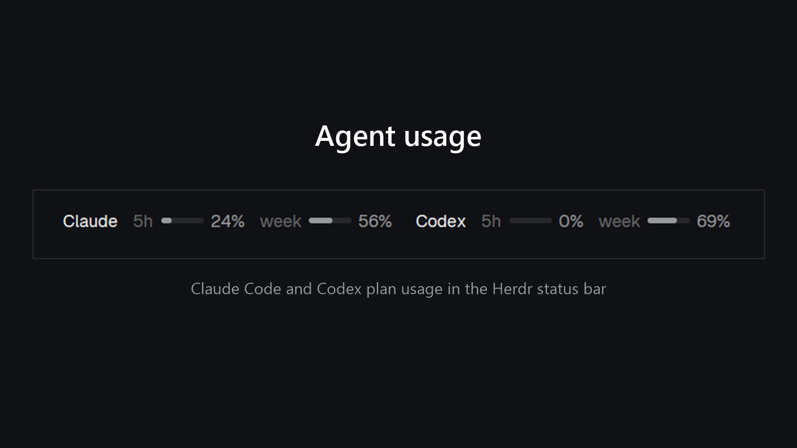
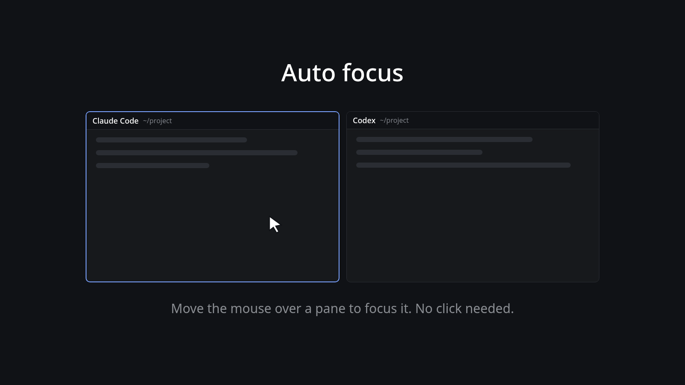

# Herdr mods

Custom mods for the [Herdr](https://herdr.dev) desktop app. Each mod is a folder you can copy into `~/.config/herdr-app/`, with its own `README.md`, `RECIPE.md` and `preview.png`.

## Mods

### [agent-usage](agent-usage/)

Your coding agents' plan usage in the Herdr status bar, read from local files. No network calls, no login tokens.

- **Codex:** 5-hour and weekly percent used, with small meters, from its session logs.
- **Claude Code:** 5-hour and weekly percent used (Pro, Max and Ultra plans), saved by a small status line wrapper; falls back to token counts without it.
- Amber at 70%, red at 90%.
- Click the readout for a popup in the style of the Claude and Codex usage pages: each limit with percent used and left, a bar and its reset time.

[Install and details](agent-usage/README.md)

### [auto-focus](auto-focus/)

Focus follows the mouse. Move the pointer onto a pane and it takes the keyboard, no click needed. Keeps the normal pane header with its split, zoom and close buttons.

- Works anywhere in the pane, not just on the header bar.
- A drop-in pane header (`hover-focus`): point your layout's `pane.header` at it.

[Install and details](auto-focus/README.md)

## License

MIT
