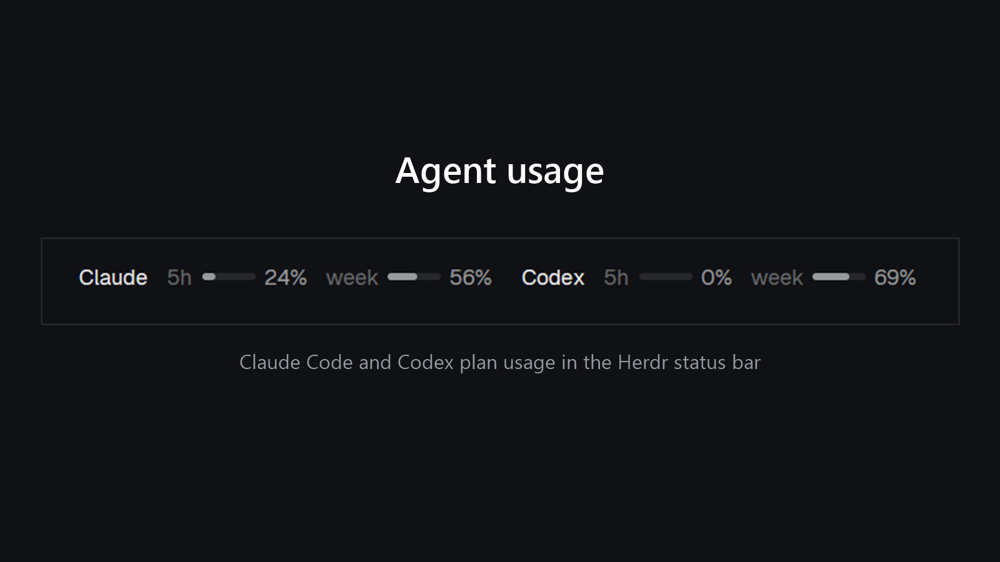

# Herdr Agent Usage

Your coding agents' plan usage in the Herdr status bar, from local files. No network, no login tokens.



- **Codex**: `5h ▬ 100%  week ▬ 69%`, percent of your limits *used*, with small meters. It reads the latest `rate_limits` event (by timestamp, across your 8 newest sessions) in `~/.codex/sessions`. Codex's own screen may show percent *left*.
- **Claude Code**: `5h ▬ 22%  week ▬ 56%`, from the `rate_limits` Claude Code passes to its status line (Pro, Max and Ultra plans). A small wrapper saves them (see below). Without it, the segment falls back to token counts (`5h 488k tokens`, `today 488k tokens`) read from `~/.claude/projects`.

Amber at 70% used, red at 90%. The bar refreshes every 2 minutes.

## The usage panel

Click the Claude / Codex readout for a panel in the style of the Claude and Codex usage pages. Click outside it to close.

- **Claude:** *Current session (5-hour)* and *Weekly limit (all models)*, each with percent used and left, a bar and its reset (`Resets in 43 min`, `Resets Sat 8:00 AM · in 5 d 10 hr`), plus today's and the last 5 hours' token counts. Claude has no daily limit, so the daily figure is a token count from your local logs.
- **Codex:** *5-hour usage limit* and *Weekly usage limit* the same way, with when Codex last logged a reading.
- A **Refresh** button re-reads everything. A reading older than 30 minutes (Claude) or 6 hours (Codex) is shown in amber.

It is Herdr's `workspace-status` bar with this segment added, so it replaces that bar.

## Install

1. Copy `mods/agent-usage/` to `~/.config/herdr-app/mods/`.
2. In your layout, point the status block at it:

   ```json
   { "id": "status", "type": "block", "size": { "px": 28 }, "content": { "mod": "agent-usage" } }
   ```
3. `herdr-app check ~/.config/herdr-app/mods/agent-usage`, then `layout.switch`.

## Claude plan percentages (optional)

1. Copy `claude/statusline-herdr.cjs` to `~/.claude/`.
2. If you already have a status line, put its command on one line in `~/.claude/statusline-herdr.next` (for example `node ~/.my-statusline.js`). The wrapper runs it with the same input and prints its output unchanged. No file, no passthrough.
3. In `~/.claude/settings.json` set `statusLine.command` to `node ~/.claude/statusline-herdr.cjs`.

The wrapper writes `~/.config/herdr-app/data/agent-usage/claude-limits.json` whenever Claude Code reports limits, which is after each API response. Between sessions the bar shows the last saved reading; a window that has already reset shows 0%.

## Limits

- Works on Windows, Linux and macOS. The mod picks the token-fallback method itself (`window().platform`): PowerShell (`usage.ps1`) on Windows, `find` plus JS on Linux and macOS, so there is nothing OS-specific to install. Linux and macOS need `find` on the PATH.
- Codex shows its last logged event, so it lags until Codex runs again.
- Based on Herdr's shipped `workspace-status` (0.1.13); it won't follow later changes to it.
