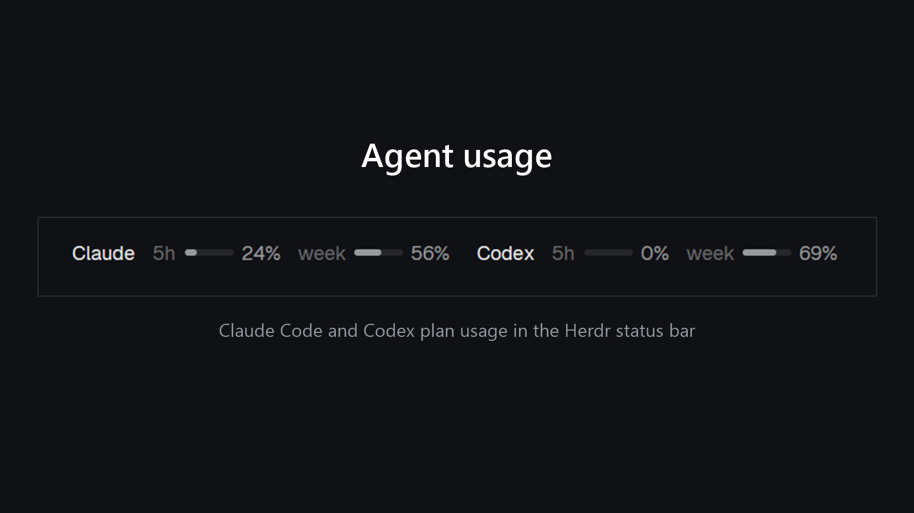

# Herdr Agent Usage

The status bar with Claude Code and Codex plan usage on the right, before the palette hint.

## What you see
A 28px bar (`chrome` bg, top border, 11.8px `muted` text). Left to right: machine, git branch, "N agents" with a red "· N needs you" when blocked, a flexible gap, **Claude**, **Codex**, the palette hint. Each provider is its name in `foreground` medium weight, then two windows: a `dim` label (`5h`, `week`), a 30×4px meter (`border` track, rounded) filled to the percent used, and the percent. Meter and number are `muted`, `working` at 70% and `blocked` at 90%. Before the first read: "Claude …" / "Codex …". Without Claude limits it shows `5h 488k tokens`, `today 488k tokens` instead. On failure: "—" with the reason in a tooltip.

## How it behaves
Reads on start and every 120 s. Tooltips: the window and when it resets; for Claude, when the reading was saved and the token counts.

Clicking the Claude/Codex readout (`Popover`, `anchor("bottom_right")`, controlled `open`) opens a 360px panel (`popover` bg, 1px `border`, radius 10, `shadow_lg`, 14px padding, 16px gap): header "Plan usage limits" with a Refresh text button; a Claude section (8px #D97757 dot, name, "updated N min ago"), rows "Current session (5-hour)" and "Weekly limit (all models)"; a divider; a Codex section (#10A37F dot, "last activity N min ago"), rows "5-hour usage limit" and "Weekly usage limit"; a dim footer line. Each row: label left and "N% used" right, a 6px full-width bar (`border` track, fill `accent`, `working` from 70%, `blocked` from 90%), then "Resets in 43 min" or "Resets Sat 8:00 AM · in 5 d 10 hr" left and "N% left" right. Claude also lists "Today" and "Last 5 hours" token counts with a note that Claude has no daily limit. Clicking outside closes it.

## Built from
One mod, `agent-usage`, cloned from `workspace-status` (`mod.clone`), `place: "none"`. `main.js` uses `herdr` (`spaces`, `agents`, `theme`, `run`, `window`, `keys`, `exec`, `home`, `appHome`), `gpui-base` `h_flex`, and `fs/promises`.
- **Codex**: the newest 8 files under `~/.codex/sessions/Y/M/D`; the match with the latest event timestamp of `"timestamp":"…"` … `"primary":{"used_percent":…,"window_minutes":…,"resets_at":…},"secondary":{…}`. File names are local time and events are UTC, so pick by event timestamp, not by name. A window whose `resets_at` has passed shows 0.
- **Claude percent**: reads `data/agent-usage/claude-limits.json` in the app home: `{at, five_hour:{used,resetsAt}, seven_day:{…}}`. `claude/statusline-herdr.cjs` writes it from the `rate_limits` of Claude Code's status line input (`five_hour.used_percentage`, `seven_day.used_percentage`, `resets_at`), then runs the command in `~/.claude/statusline-herdr.next` with the same stdin and prints its output. It expands a leading `~` itself because it runs the command through cmd.exe on Windows.
- **Claude tokens (fallback)**: `usage.ps1` via `exec("powershell", ["-NoProfile","-ExecutionPolicy","Bypass","-File", …])` sums `input + output + cache_creation` of assistant messages (deduped by message id) from the last 5 h and today in `~/.claude/projects`; one JSON line.

## Watch out
No network and no tokens. `readdir` has no mtimes. Cache reads are left out of the token fallback. Codex shows percent used, Codex's own screen may show percent left. `rate_limits` only exists for Pro, Max and Ultra and only after a session's first API response. Only one `statusLine` command is allowed, hence the wrapper. `usage.ps1` is Windows only.

## Done when
`herdr-app check` passes; the bar shows both segments; Codex percents match the latest `rate_limits` in the logs; Claude percents match the status line's `rate_limits` once a session has made a request.
