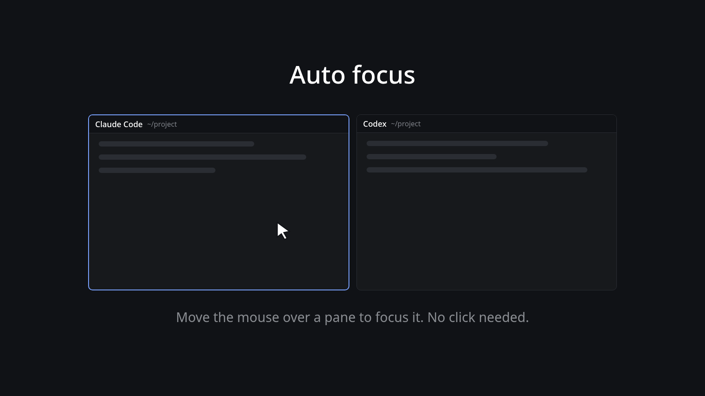

# Herdr Auto Focus

Focus follows the mouse: move the pointer onto a pane and it takes the keyboard. No click needed.



*The image is an illustration, not a screenshot.*

- Hover anywhere in a pane, its header or its terminal, and that pane is focused.
- A pane that is already focused is left alone, so nothing re-runs while you move around inside it.
- Keeps the normal pane header: program icon, agent or terminal name, folder, agent status, and the split right, split down, zoom and close buttons on hover.

It is Herdr's shipped `pane` header with a transparent overlay added, so it replaces that header. It uses no network and reads no files.

## Install

There is nothing to build: the mod is plain JavaScript and works the same on Linux, macOS and Windows. The installer only finds your Herdr app home and copies the mod there.

**Linux / macOS** (also Git Bash on Windows, which hands off to the PowerShell script):

```sh
./install.sh --layout main        # or any layout name; leave out --layout to only copy the mod
```

**Windows** (PowerShell):

```powershell
.\install.ps1 -Layout main
```

The app home is `$HERDR_APP_HOME` if set, otherwise `~/.config/herdr-app` (`%USERPROFILE%\.config\herdr-app` on Windows). Use `--home DIR` / `-AppHome DIR` if yours is elsewhere. The script copies `mods/hover-focus/`, runs `herdr-app check`, and with `--layout` / `-Layout` points that layout's pane header at the mod, keeps a `.bak-before-hover-focus` copy of the layout file, and switches to it. `--layout` on Linux/macOS needs `jq`.

**By hand**, the same thing:

1. Copy `mods/hover-focus/` to `~/.config/herdr-app/mods/`.
2. In your layout, point the pane header at it (the tab block's `pane.header`):

   ```json
   "header": { "content": { "mod": "hover-focus" }, "height": 30, "position": "top", "reveal": "always" }
   ```
3. `herdr-app check ~/.config/herdr-app/mods/hover-focus`, then `layout.switch`.

Keep `"reveal": "always"` and the 30px height: the overlay is positioned from the header's bottom edge. With `"reveal": "hover"` the header would only exist while the pointer is over a pane.

## Limits

- Tested on Herdr 0.1.14 on Linux (KDE Plasma, Wayland). Not tried on macOS or Windows.
- Windows: the mod runs no programs and reads no files, so nothing in it is OS-specific except the folder shown in the header. Windows paths (`C:\Users\you\proj`) are shortened to `~/proj` like Linux and macOS ones, with the drive letter compared without case. That part is unit-tested. `install.ps1` and the mod have not been run on a Windows machine, and the Windows app-home path above is the documented `~/.config/herdr-app` read as `%USERPROFILE%`, not confirmed.
- The overlay is an absolutely positioned element drawn outside the 30px header (8000×8000 px, nothing is clipped). It relies on the app not clipping a header mod to its own box. If a later Herdr version does, hover focus will only work over the header bar.
- Mods can't see the mouse anywhere else, so this only covers panes of the tab the layout shows.
- Based on Herdr's shipped `pane` header (0.1.10); it won't follow later changes to it.
