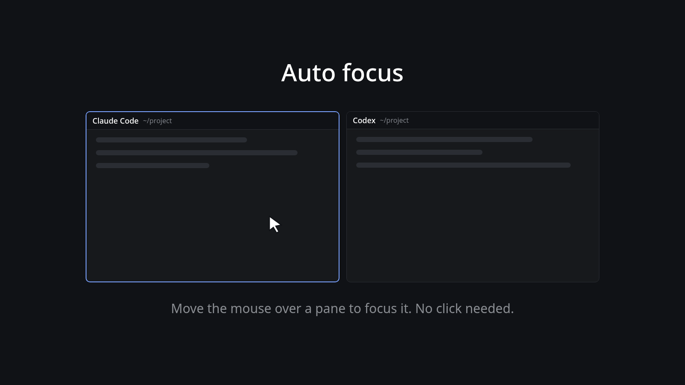

# Herdr Auto Focus

Focus follows the mouse for Herdr's panes: hovering a pane focuses it, and every pane keeps its normal top bar.

## What you see
The usual pane header (30px, `background`, 1px bottom `border`, 12px text, 10px side padding): the program's icon, then the agent's name or the terminal's title in `foreground` medium weight, the folder (`~` for home) in `dim`, then the agent state: a spinner while working, a "Needs you" pill in `blocked` when blocked, a `done` dot when done. While the pointer is on the bar, four 14px icon buttons appear at the right: split right, split down, zoom or unzoom, close. Nothing else is drawn: the focus effect is invisible except that the pane's focus border moves to the pane under the pointer.

## How it behaves
Pointer enters a pane's header or terminal and the pane focuses (`pane.focus {pane}`), unless it already has focus. Leaving does nothing: the last pane entered keeps focus until the pointer enters another. Clicks on the header still focus the pane; the buttons still split, zoom and close without the click reaching the header (`cx.stop_propagation()`).

## Built from
One mod, `hover-focus`, cloned from the shipped `pane` header (`mod.clone`), `place: "none"`. `main.js` uses `herdr` (`panes`, `props`, `run`, `theme`, `home`) and `gpui-kit` (`View`, `div`, `svg`, `image`), `gpui-base` `h_flex`. Its five icons and the spinner are copied into `mods/hover-focus/` so it doesn't depend on other mods' files.
- `focusMe()`: finds this pane in `panes()` by `props().pane`; if `focused` is false, `run("pane.focus", { pane })`.
- The header row's `on_hover` calls `focusMe()` when `hovered` is true.
- The overlay is the last child of the header row: `div().id("hover-focus-<pane>").absolute().top(30).left(0).w(8000).h(8000)` with `on_hover` calling `focusMe()`. No background, so it is invisible.
- Layout: the tab block's `pane.header` is `{ "content": { "mod": "hover-focus" }, "height": 30, "position": "top", "reveal": "always" }`.

## Watch out
- The overlay only works because the app doesn't clip a header mod to its own bounds. Check this first on a new Herdr version: hover the middle of a pane, not the bar.
- A header with a tall `height` and `reveal: "always"` does not work as an overlay: it takes the pane's space and hides the terminal. `reveal: "hover"` draws it over the terminal but then the bar is hidden until hovered. The absolute child of a normal 30px header is what gives both.
- The overlay has no background and no `occlude`; adding either is untested and may block clicks to the terminal.
- Hover is the only trigger; there is no delay, so a fast pointer sweep across panes will focus each in turn.

## Done when
`herdr-app check mods/hover-focus` passes and `herdr-app status` shows no errors after `layout.switch`; each pane shows its header with the icon, name and folder; moving the pointer, without clicking, over the middle of another pane moves the focus border to it and `focused_pane` in `herdr-app status` changes; the buttons on hover still split, zoom and close.
